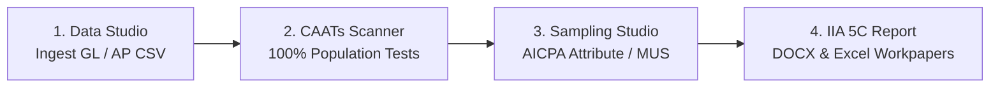

# AuditDesk — Fieldwork & Forensic Workbench for Internal Auditors

<p align="center">
  <b>A lightweight, privacy-first, zero-dependency audit fieldwork workbench for internal auditors and consultants.</b>
  <br />
  <sub>100% population CAATs forensics, AICPA statistical sampling, interactive charts, and IIA-aligned Word & Excel workpaper generation.</sub>
</p>

<p align="center">
  
  
  
  
  
</p>



---

## Quick Start (Zero Configuration)

AuditDesk requires no database configuration, no Docker, and no environment setup.

### Windows
Double-click `AuditDesk.bat`.
> *Auto-detects Python, installs dependencies if needed, starts the local session server, and opens `http://localhost:8090`.*

### macOS / Linux
Run:
```bash
./AuditDesk.sh
```

---

## Fieldwork Workflow

AuditDesk follows the IIA International Professional Practices Framework (IPPF) audit lifecycle:

### Option A: The 1-Click Auto-Pilot (Fastest)
1. Launch the app and click the **`⚡ 1-Click Auto-Pilot`** button on the top navigation bar.
2. In **0.3 seconds**, AuditDesk will:
   * Ingest and profile the full ledger population.
   * Run all 4 deterministic CAATs forensic tests.
   * Extract a statistically valid AICPA attribute sample (Seed 42).
   * Draft IIA 5C observation finding tables with root causes.
   * Synthesize the executive audit report with an overall assurance rating.
3. Click **`Export IIA Report (.DOCX)`** or **`Download Master Workpaper (.xlsx)`** to save your deliverables.

---

### Option B: Interactive Fieldwork Step-by-Step

#### Step 1: Ingest & Profile Your Ledger (Data Studio)
* **Drag-and-drop** your client's raw Accounts Payable CSV or general ledger file into the upload zone (or click *"Load Demo Dataset"*).
* Review the **Vendor Pareto Spend Bar Chart** and **Daily Posting Timeline** to understand data density and transaction velocity.

#### Step 2: Run 100% Population Forensic Tests (Forensic Scanner)
* Set your Delegation of Authority (DOA) limit (*e.g., $5,000*).
* Click **`Scan 100% Population`** to run 4 deterministic algorithms:
  * **Split Purchases:** Flags sequential purchase orders structured just below approval thresholds within a rolling 7-day window.
  * **Duplicate Payments:** Matches exact and fuzzy duplicate disbursements (e.g., invoice `INV-9081` vs `INV-9081-A`).
  * **Benford's Law Chi-Square ($\chi^2$):** Analyzes 1st-digit logarithmic conformity to detect artificial or manipulated amounts.
  * **Off-Hours / Weekend Postings:** Identifies transactions approved during non-working days.

#### Step 3: Extract Regulator-Defensible Samples (Sampling Studio)
* **Attribute Sampling (Internal Controls Testing):** Configure Tolerable Deviation Rate (TDR), Expected Population Deviation Rate (EPDR), and Confidence Level (90% or 95%) to calculate AICPA sample sizes.
* **Monetary Unit Sampling (MUS):** Substantive dollar-weighted sampling for high-value financial statement items.
* All draws use a fixed random seed (**Seed 42**) for 100% regulator and peer-review reproducibility.

#### Step 4: Draft 5C Audit Findings (Finding Drafter)
* Review flagged exceptions and generate structured observations using the **IIA 5C Framework**:
  * **Criteria:** Applicable corporate policy, authorization limits, or IFRS/GAAP standards.
  * **Condition:** The factual evidence and transactions identified during testing.
  * **Cause:** Systemic root cause (e.g., lack of automated ERP validation controls).
  * **Consequence:** Commercial risk exposure, financial leakage, or compliance penalties.
  * **Corrective Action:** 30/60/90-day SMART remediation plan with designated management owners.

#### Step 5: Sign-off & Export Workpapers (Workpaper & Sign-off)
* Perform **Preparer Dual Sign-off** and **Reviewer Sign-off** with immutable timestamp records.
* **Download Official Deliverables:**
  * 📄 **IIA Executive Report (`.docx`):** Microsoft Word document formatted to IIA standards with Executive Summary, Assurance Rating, Scorecard, and 5C Finding tables.
  * 📊 **Master Workpaper Package (`.xlsx`):** Multi-sheet Excel workbook with population reconciliations, sampled test items, and duplicate cross-references.

---

## 🔒 Privacy & Security First

* **Zero Cloud Data Exfiltration:** Client financial data never leaves your laptop.
* **100% Ephemeral In-Memory Storage:** No persistent database files are stored on disk. When you close the terminal, session memory is cleared.
* **Offline Operation:** Fully functional air-gapped without an internet connection using the built-in Expert Rule Engine.

---

## 🚀 Key Capabilities

```
┌─────────────────────────────────────────────────────────────────────────────┐
│ 1. ⚡ 1-CLICK AUTO-PILOT FIELDWORK PIPELINE                                 │
│ Scans 100% of transactions, detects exceptions, calculates Benford's Law,  │
│ extracts an AICPA attribute sample (Seed 42), and synthesizes an executive  │
│ IIA compliant board report in under 1 second.                               │
├─────────────────────────────────────────────────────────────────────────────┤
│ 2. 🔬 DETERMINISTIC FORENSIC CAATs (ZERO HALLUCINATION)                     │
│ • Split Purchases: Detects transactions structured just below DOA limits.   │
│ • Duplicate Payments: Identifies exact and fuzzy duplicate disbursements.   │
│ • Benford's Law Chi-Square: Evaluates first-digit logarithmic conformity.   │
│ • Out-of-Hours Entries: Flags unauthorized weekend/off-hours postings.      │
├─────────────────────────────────────────────────────────────────────────────┤
│ 3. 📊 STATISTICAL SAMPLING STUDIO (AICPA & MUS)                             │
│ • Attribute Sampling for internal controls testing (TDR, EPDR, Confidence). │
│ • Monetary Unit Sampling (MUS) for dollar-weighted substantive testing.     │
│ • Fixed-seed reproducibility (Seed 42) for rock-solid regulator audits.     │
├─────────────────────────────────────────────────────────────────────────────┤
│ 4. 📄 IIA COMPLIANT EXECUTIVE REPORT & WORKPAPERS                           │
│ • DOCX Report: Microsoft Word deliverable formatted to IIA standards        │
│   with Overall Assurance Rating, 5C Observation tables, and 30/60/90 CAPA.  │
│ • XLSX Master Workpaper: Multi-tab Excel workbook with audit trails.        │
├─────────────────────────────────────────────────────────────────────────────┤
│ 5. 📈 INTERACTIVE VISUAL ANALYTICS                                          │
│ • Benford's Law Expected vs. Observed Digit Frequencies                     │
│ • Top 5 Vendors Pareto Spend & Exposure Concentration                       │
│ • Posting Velocity & Day-of-Week Distribution Timeline                      │
│ • 100% Population Anomaly Risk Composition Donut                            │
├─────────────────────────────────────────────────────────────────────────────┤
│ 6. 🔒 PRIVACY-FIRST & ZERO-DB ARCHITECTURE                                  │
│ • 100% Ephemeral in-memory session. Client data never leaves your laptop.   │
│ • Air-gapped offline operation with built-in Expert Rule Engine.            │
│ • Optional BYOK AI (Gemini / OpenAI / Claude / DeepSeek) for narrative synthesis.│
└─────────────────────────────────────────────────────────────────────────────┘
```

---

## 📊 Performance & Scale Benchmarks

Tested and verified across large enterprise general ledgers and Kaggle financial transaction datasets:

| Dataset Scale | Ledger Value | Total Pipeline Time | Analytic Throughput |
| :--- | :--- | :--- | :--- |
| **5,000 Rows** | \$142.22 Million | **0.357 seconds** | **14,009 rows / sec** |
| **25,000 Rows** | \$706.01 Million | **0.405 seconds** | **61,801 rows / sec** |
| **100,000 Rows** | **\$2.879 Billion** | **1.122 seconds** | **89,150 rows / sec** |
| **250,000 Rows** | **\$7.218 Billion** | **2.685 seconds** | **93,100 rows / sec** |

---

## 📂 Codebase Structure

```
auditdesk/
├── AuditDesk.bat           # 1-Click Windows desktop launcher
├── AuditDesk.sh            # 1-Click macOS / Linux launcher
├── launch.py               # Cross-platform Python launcher
├── server.py               # Threading HTTP server & ephemeral memory engine
├── requirements.txt        # Minimal dependency file (python-docx)
├── LICENSE                 # MIT License
├── README.md               # Documentation & User Guide
│
├── data/
│   └── sample_ap_invoices.csv  # Pre-packaged demo AP ledger (30 transactions)
│
├── engine/
│   ├── ai_client.py        # BYOK multi-provider LLM connector + offline expert rules
│   ├── forensics.py       # O(N) split limits, fuzzy duplicate matching, Benford, weekends
│   ├── sampling.py        # AICPA Attribute & Monetary Unit Sampling (MUS)
│   └── workpaper_export.py# IIA Compliant Word (.docx) and Excel XML workpaper generators
│
├── static/
│   ├── index.html         # Responsive Tailwind + FontAwesome single-page workbench
│   └── app.js             # Client-side reactivity, Chart.js graphs, and Auto-Pilot flow
│
└── tests/
    ├── test_workbench.py          # Core engine unit tests
    ├── test_server_integration.py # 100% REST API endpoint validation suite
    ├── test_deep_debug.py         # Corrupted data & boundary conditions test
    ├── stress_test_kaggle.py     # 100,000-row enterprise benchmark
    └── extreme_limit_tests.py     # Chaos fuzzing & 250k-row extreme limit harness
```

---

## 🧪 Running Automated Tests

```bash
# 1. Run core unit tests
python -u tests/test_workbench.py

# 2. Run REST API integration tests (11/11 endpoints)
python -u tests/test_server_integration.py

# 3. Run deep debugging & corrupted input resilience suite
python -u tests/test_deep_debug.py

# 4. Run enterprise scale stress benchmark (100k rows / $2.8B)
python -u tests/stress_test_kaggle.py

# 5. Run chaos fuzzing & 250k-row extreme limits test
python -u tests/extreme_limit_tests.py
```

---

## 👨‍💼 Creator & Attribution

**Majid Mumtaz** (CIA, ACA, FCCA)
*Director of Internal Audit & Risk Advisory | GRC Leader*

* 📡 **Newsletter:** [The Audit Signal (LinkedIn)](https://www.linkedin.com/newsletters/the-audit-signal-7339153291630510080/)
* 🌐 **Portfolio:** [majidrajpar.github.io/portfolio_my](https://majidrajpar.github.io/portfolio_my/)
* 💼 **LinkedIn:** [linkedin.com/in/majidrajpar](https://www.linkedin.com/in/majidrajpar/)
* ✉️ **Contact & Feedback:** `majidrajpar@gmail.com`

---

## 📄 License

AuditDesk is open-source software licensed under the [MIT License](LICENSE).
